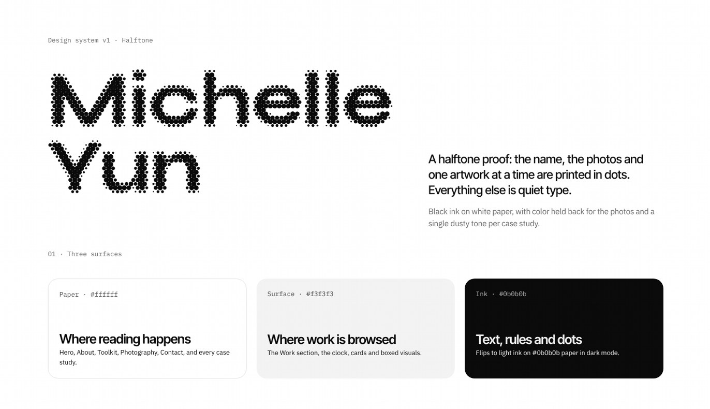
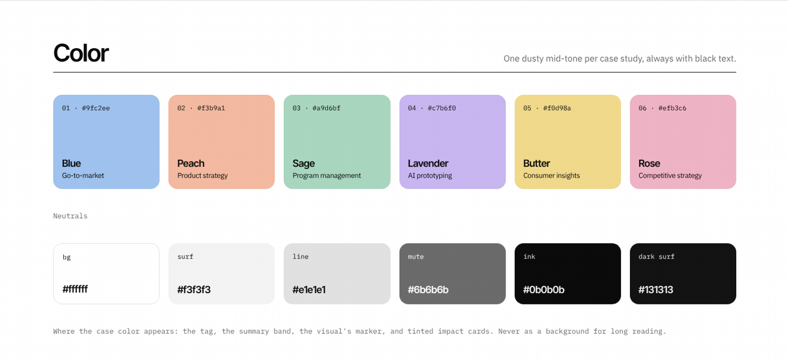
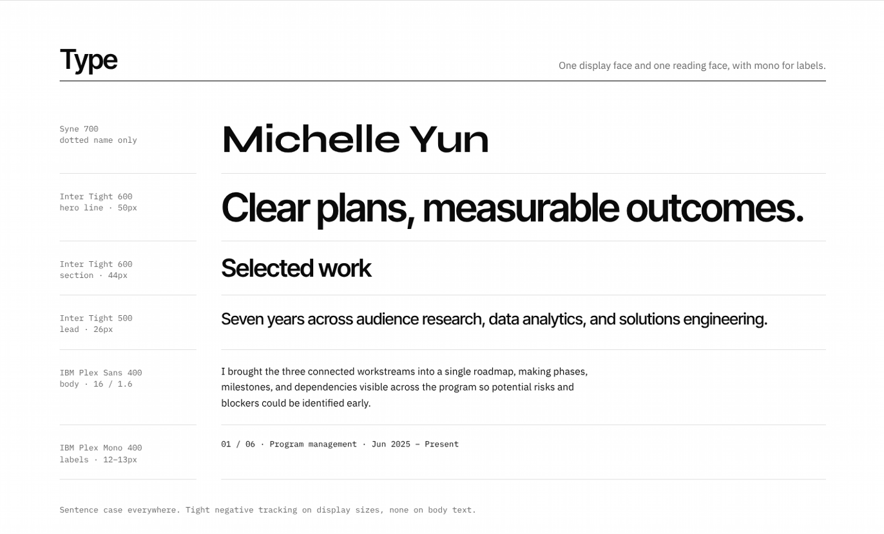
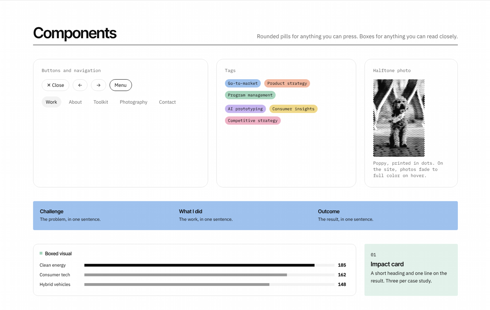
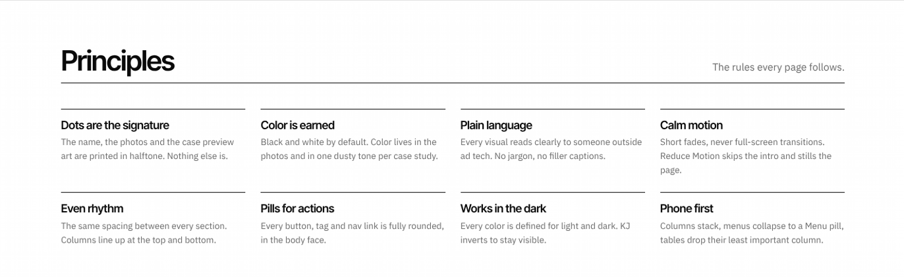

# Design system · Halftone

The colors, type, components and principles behind [michelleyun.github.io/portfolio](https://michelleyun.github.io/portfolio/).

**The idea:** a halftone proof. The name, the photos and one artwork at a time are printed in dots. Everything else is quiet type, in black ink on white paper.

- [Live board](https://michelleyun.github.io/portfolio/design-system/): the same board as a web page, in the real fonts
- [tokens.css](tokens.css): every color, font and spacing value in one file

## Color

Black and white by default. Color is held back for the photos and for one dusty mid-tone per case study, always paired with black text.

| Token | Light | Dark | Used for |
|---|---|---|---|
| `--bg` | `#ffffff` | `#0b0b0b` | Page |
| `--ink` | `#0b0b0b` | `#efefef` | Text, rules, dots |
| `--mute` | `#6b6b6b` | `#8f8f8f` | Secondary text |
| `--line` | `#e1e1e1` | `#262626` | Hairlines, button borders |
| `--surf` | `#f3f3f3` | `#131313` | Work section, cards, clock |

| Case | Color | Focus |
|---|---|---|
| 01 | Blue `#9fc2ee` | Go-to-market |
| 02 | Peach `#f3b9a1` | Product strategy |
| 03 | Sage `#a9d6bf` | Program management |
| 04 | Lavender `#c7b6f0` | AI prototyping |
| 05 | Butter `#f0d98a` | Consumer insights |
| 06 | Rose `#efb3c6` | Competitive strategy |

The case color appears in four places only: the tag, the summary band, the marker on each visual, and the tinted impact cards.

## Type

| Role | Face | Size |
|---|---|---|
| Dotted name | Syne 700 | Fills the first screen |
| Hero line | Inter Tight 600 | up to 50px |
| Section heading | Inter Tight 600 | up to 52px |
| Lead text | Inter Tight 500 | up to 27px |
| Body | IBM Plex Sans 400 | 16px / 1.55 |
| Labels, tags, numbers | IBM Plex Mono 400 | 12–13px |

Sentence case everywhere. Display sizes use tight negative tracking. Body text uses none.

## Components

- **Pill buttons:** every button, nav link and tag is fully rounded and set in the body face.
- **Tags:** the case color with black mono text.
- **Halftone photos:** printed in dots, fading to full color on hover (or tap on phones).
- **Summary band:** Challenge · What I did · Outcome, in the case color.
- **Boxed visual:** a hairline box with a small case-colored marker beside the title.
- **Impact cards:** three per case study, tinted with the case color.

## Principles

## Layout and motion

- Side margin `max(4vw, 16px)`, content up to 1440px wide, fixed 60px header.
- The same padding between every section, and 56px between parts of a case study.
- Motion is limited to short fades. With Reduce Motion on, the intro is skipped and KJ runs in place.
- Every color is defined for light and dark mode.
